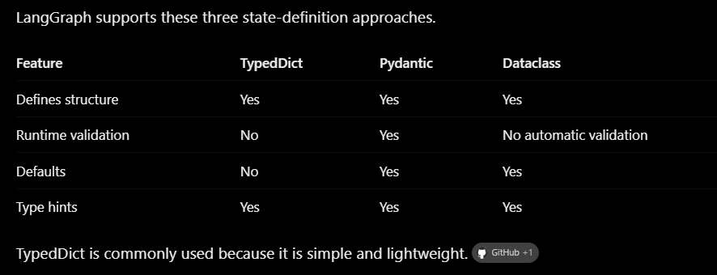

state vs db

1. State

Understand:
- What is State in LangGraph?
- Why does an agent need State?
- How does State store information?
- What is a TypedDict? 
- How do nodes read and update State?
- How does State move between nodes?
Goal: Understand how information is shared and maintained throughout a graph.

#  What is State in LangGraph?
- state is shared memory in graph , holding the messages and the results an agent need to run 
# Why does an agent need State?
Because the agent works in several steps, and each step needs to know what happened in the earlier ones. Without State, the LLM node wouldn’t see the tool’s result, and the tool node wouldn’t know what the LLM asked for. State keeps all the messages and results in one place so every step can use them.

# How does State store information?

1. **Define the State:** a field called `messages`, which starts as an empty list.
2. **User asks:** "How far is Ali's shop from my home?" is added to `messages`.
3. **LLM node runs:** it reads `messages` and asks for the "find address" tool. That request is added to `messages`.
4. **Tool node runs:** it reads the request from `messages`, runs "find address", and the address result is added to `messages`.
5. **LLM node runs again:** it reads `messages`, which now includes the address, and asks for "calculate distance" using that address. That request is added to `messages`.
6. **Tool node runs again:** it runs "calculate distance", and the distance result is added to `messages`.
7. **LLM node runs again:** it reads the whole `messages` list, has no more tool requests, and writes the final answer. The answer is added to `messages`.

The State kept growing at every step, so each node could see everything that happened before it.

#  What is a TypedDict? 
- TypedDict is a class from python's module typing
- its not something provided by langgrapgh 
- we just use TypedDict in langGraph to define structure of state
- it lets you define what keys a dictionary can hold and what type of data (datatype) the key can hold
- for examaple :
    class Student(TypedDict):
             name: str
- Student defines the strcuture of dictinary
- name should contain string value 
- then we can create a normal python dictionary to store the actual value (data)
- ### Note : the important difffernce between both is that typeddict tels the strcuture means key & datatype of value a key will be holding and a normal dictionary contain actual values of those keys
- TypedDict defines the structure of your State.
- The State dictionary holds the actual data.
# Does every node receive the same State?
Generally, yes.
# Does TypedDict create the actual dictionary?
No.
# What are required and optional keys?
- By default, TypedDict keys are required.
- we can also make them optional like  age: NotRequired[int]
# Does TypedDict update the State?
No
- TypedDict only defines the structure.
- LangGraph manages state updates.
- The node returns an update.
- LangGraph applies that update to the graph's state.
- there is  a difference between defining state and updating state.

# difference between defining state and updating state.

# points to remmber
1. TypedDict comes from Python's typing module.
2. It defines the expected structure of a dictionary.
3. It specifies keys and their expected value types.
4. It does not create an actual dictionary.
5. It does not automatically validate values at runtime.
6. LangGraph uses it to define State.
7. Nodes receive the graph's state and return updates.
8. LangGraph manages how those updates are applied.
9. TypedDict itself does not manage graph execution.
10. It is a schema, not a state-management mechanism.
# Database Vs state in langgraph
1. State stores temporary data during a LangGraph execution, such as human and AI messages.
2. Database stores data permanently, so you can retrieve it even after the application or session restarts.
3. State manages the agent's working context, while a database provides long-term data storage.

# How do nodes read and update State?
1. langGraph passes the current state to a node
2. node reads the field values it need from state
3. the node perform its tasks
4. it return the update as a normal python dictionary
5. langchain prfrom that update to the state 
6. the nxt node rcv the updated state

# complete flow with one example.
1. Define the State
    - This defines what information State can hold.
2. Node reads State
   - read value of message from state
3. Node processes the information
   - The node reads the user's message and generates a response.
4. Node updates State
    - return {"response": answer} tells LangGraph to update the response key in State.
    - It does not mean the node replaces the entire State.
5. LangGraph applies the update
   - The original message remains unchanged after update of state 
6.  Next node reads the updated State
   - This node receives the latest State, including the update made by the previous node.
   - now if we proceess the existing key of the state in second node the old value of that key  will get replaced by the new value 
7. What actually controls the update?
   - This is where reducers matter.
   - By default, LangGraph uses overwrite behavior.
   - For example, if we have a messages list and want to append new messages instead of replacing the old ones, we use a reducer such as add_messages.
# Situation	                                         What happens
- Node returns an existing key	                     Its value gets replaced
- Node returns a new key	                         That key gets updated
- Node doesn't return a key	                         Its previous value stays unchanged
- Node returns a key with a reducer	                 The reducer decides how to combine values

#  How does State move between nodes?

- when a node finished the langgraph follows the edge to find the nxt node
gives that node the updated state as input
- When a node finishes, LangGraph applies the node’s returned update to the State, then passes the updated State as input to the next node.
- For example, the LLM node returns its reply, LangGraph adds it to messages, and the tool node then receives the State that already contains that reply.

